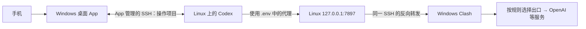

# Linux 云服务器使用 Codex 指南

这篇带你在 Linux 服务器上安装 Codex、完成一次项目任务，再通过 Windows App 和手机继续操作。

先完成[第一篇：基础环境配置](linux-server-setup.md)。适用环境：Windows + Ubuntu 24.04 + Bash。更新：2026-10-17。

文中 `dev-server` 是普通 SSH 连接，`dev-server-proxy` 是带代理的连接，端口为 7897；请与第一篇保持一致。命令前会注明在 **Windows** 还是 **Linux** 执行。

先记住整个过程：**首次安装用 WT 手工代理 → 安装、配置 `.env` 并登录 → 关闭手工代理连接 → App 改用 `dev-server-proxy`，负责日常连接。**其他 WT 窗口仍可用普通 SSH。

## 1. 安装与更新

首次安装还没有可用的远端 Codex，先用手工连接准备环境。需要代理时，启动 **Windows Clash**，再在 **WT 的 PowerShell** 中连接服务器：

```powershell
ssh dev-server-proxy
```

安装阶段保持窗口在线，在连接后的 **Linux 普通用户终端**设置第一篇的[临时下载代理](linux-server-setup.md#6-验证链路并设置临时下载代理)，再安装。它用于先下载软件，不是日后每次打开 App 都要执行的步骤：

```bash
npm install -g @openai/codex@latest
codex --version
```

第一条安装最新 Codex，`-g` 让它能在不同项目里运行；第二条应显示版本号。使用第一篇的 fnm 环境时，不需要加 `sudo`。以后更新也运行同一条安装命令。[官方安装示例](https://developers.openai.com/cookbook/examples/codex/using_goals_in_codex)

## 2. 保存 Codex 运行代理

这一步让 Codex 以后启动时可以使用保存好的代理设置。服务器能够直连时可以跳过。

先分清两件事：

- 第一篇的 `export`：给当前终端里的安装、下载命令用。
- 这里的 `.env`：给 Codex 启动用，不会自动配置其他独立的 curl、npm 或 APT。

以下在 **Linux 日常用户终端**执行：

```bash
whoami               # 确认是以后运行 Codex 的用户
mkdir -p ~/.codex     # 准备配置目录，已有目录会保留
micro ~/.codex/.env   # 打开代理配置文件
```

保留已有内容，添加或更新下面几行。大小写两组变量按原样保留：

```dotenv
HTTP_PROXY=http://127.0.0.1:7897
HTTPS_PROXY=http://127.0.0.1:7897
ALL_PROXY=http://127.0.0.1:7897
http_proxy=http://127.0.0.1:7897
https_proxy=http://127.0.0.1:7897
all_proxy=http://127.0.0.1:7897
NO_PROXY=localhost,127.0.0.1,::1
no_proxy=localhost,127.0.0.1,::1
```

Ctrl+S 保存、Ctrl+Q 退出，再限制文件权限：

```bash
chmod 600 ~/.codex/.env  # 只允许当前用户读写
```

修改后重新启动相应 Codex 进程。配置文件不会建立通道：首次安装时由手工 SSH 提供通道；第五节交接后由 App 提供，Clash 始终需要在线。日后修改配置，也要确认 App 的远端进程已重新启动。

默认目录是 `~/.codex`。如果你设置过 `CODEX_HOME`，用 `echo "$CODEX_HOME"` 查看，并改用那个目录；root 和普通用户的配置也不共用。[目录说明](https://learn.chatgpt.com/docs/config-file/environment-variables)

此时仍在首次安装阶段。为确认 Codex 不再依赖临时 `export`，保持手工通道，在 **WT** 另开 `ssh dev-server`，不设临时代理，按下一节登录和测试。若启动文件还设置了其他代理，也要检查它们。

旧稿记录这个 `.env` 方案曾确认有效，本次没有在新服务器复测。未生效时先看末尾排障；不要为解决代理问题关闭沙箱。

## 3. 登录并完成模型调用验证

在 **Linux** 执行设备码登录：

```bash
codex login --device-auth
```

按终端提示，在 Windows 浏览器打开链接，输入本次验证码并授权。`--device-auth` 表示用设备码登录，适合没有浏览器的服务器。

个人账户需启用设备码登录，工作区可能需要管理员允许；不可用时看末尾的备用方法。验证码和登录凭据不要分享。[官方登录说明](https://learn.chatgpt.com/docs/auth#login-on-headless-devices)

登录完成后检查：

```bash
codex login status
```

显示已登录后，再进入自己的项目。把下面路径换成实际目录：

```bash
cd /path/to/your/project  # 进入项目目录
codex                    # 启动 Codex
```

发送：

> 只回复 OK，不读取或修改文件。

收到实际回复，才说明本次模型请求成功；“已登录”本身还不能证明网络和额度正常。

## 4. 用 CLI 完成一次项目任务

CLI 就是在终端里使用 Codex。首次安装测试时继续保留手工通道；第五节交给 App 后，WT 也可以通过普通 SSH 运行 CLI，共用 App 已建立的入口和同一用户的 `.env`。如果只想用 App，完成必要验证后进入第五节即可。

每次先进入项目，查看已有修改：

```bash
cd /path/to/your/project
pwd                 # 确认当前目录
git status --short  # 查看已有修改；非 Git 项目跳过
codex
```

首次接手项目，可以先发：

> 先读 README、AGENTS.md 和相关代码，说明项目怎么运行、怎么验证，以及有哪些已有修改。先不要改文件。

再给一个具体任务，例如：

> 修复空列表时的页面显示问题。保留已有修改，只改相关文件，运行相关检查，最后说明改动和结果。提交、推送前等我确认。

项目依赖仍需按项目 README 准备。遇到权限申请，先看命令、目录和影响范围；不默认用 root 或无限制权限运行 Codex。

任务结束后，退出 Codex，在 **Linux 项目目录**检查：

```bash
git status --short   # 哪些文件有变化，包括新文件
git diff            # 未暂存的改动
git diff --cached   # 已暂存的改动
```

确认修改符合要求，并查看测试或构建的实际结果，再决定是否提交、推送或发布。[CLI 入门](https://learn.chatgpt.com/docs/codex/cli)

退出后想继续，在同一用户、同一项目目录运行：

| 命令 | 用途 |
| --- | --- |
| `codex resume` | 从列表选择旧会话。 |
| `codex resume --last` | 继续当前项目最近的会话。 |
| `codex resume --all` | 也显示其他目录的会话。 |

恢复会话不保证断线期间任务一直在运行。先确认任务状态，避免重复执行会改数据的操作。[命令参考](https://learn.chatgpt.com/docs/developer-commands?surface=cli#codex-resume)

## 5. 用 Windows 桌面 App 连接服务器

旧稿称“Codex App”的入口，当前官方文档称为 ChatGPT desktop app。这里统一叫“桌面 App”，具体名称以客户端为准。

**App 本身具备 SSH 客户端能力**：它读取 Windows 的 SSH 配置，通过 OpenSSH 连接服务器。本方案让它选择带 `RemoteForward` 的连接，既操作远端 Codex，也管理代理通道，不需要另留一个 WT 代理窗口。

两条路径分开理解：



手机通过 App 操作 Linux；Linux 通过 SSH 通道借用 Windows 代理联网。项目文件、命令和测试都在 Linux 上处理，App 自身也需要正常联网。

首次从手工通道交给 App，按下面顺序操作：

1. 确认服务器 Codex 已安装、配好 `.env` 并登录，保留项目文件和已有任务。
2. 保持 Clash 在线，结束手工建立的 **`dev-server-proxy` SSH 连接**，释放服务器 7897；不要只退出 Codex 而让 SSH 还连着。
3. 在桌面 App 的设置 → **Connections / 连接**中，添加或启用 **`dev-server-proxy`**。
4. 选择 Linux 服务器上的实际项目目录，打开远端会话。
5. 让它报告当前目录和用户名，再发一个不改文件的小任务，确认模型回复和命令执行都正常。

此后由 App 管理远端连接和反向转发，不再另开相同的手工通道。**代理随承载它的 SSH 连接存活，连接断开就会失效**；关闭聊天或窗口不一定等于连接已断开，也不假设 App 会一直自动重连。异常时检查 App 连接状态和服务器端口。

App 会通过 SSH 启动远端 Codex 服务，不需要另开 CLI 给它使用，也不要把服务端口开放到公网。[官方 SSH 连接说明](https://learn.chatgpt.com/docs/remote-connections#connect-to-an-ssh-host)与 [OpenSSH 反向转发](https://man.openbsd.org/ssh_config.5#RemoteForward)

如果终端能用 Codex，App 却找不到命令，看末尾的“App 找不到 Codex”。更新 CLI 或修改代理后，也要重新连接并确认远端进程采用新设置。

### App 终端和普通 WT 怎么用

在 **App 中打开这个远端项目的终端**，先用 `pwd` 和 `whoami` 确认是 Linux，再测试：

```bash
# 测试当前终端已有的网络设置
curl -fL --max-time 30 https://github.com -o /dev/null
```

成功表示当前终端能完成这次请求。若失败，再明确指定代理，检查通道：

```bash
curl --proxy http://127.0.0.1:7897 -fL --max-time 30 https://github.com -o /dev/null
```

第二条成功说明通道可用；第一条失败时，再检查该命令的代理设置，按需临时 `export` 或检查环境变量继承。`.env` 不等于所有 App 终端程序都自动走代理，Codex 工具子进程也受[环境继承策略](https://learn.chatgpt.com/docs/config-file/config-advanced#shell-environment-policy)影响。

其他 **WT 窗口**照常执行 `ssh dev-server`。没有另设代理变量时，里面的程序继续按服务器原网络访问国内服务，不受 App 建立代理入口影响。需要下载时，可以用上面的 `--proxy` 或临时 `export` 共用入口，**不必再建立一条反向转发**。

## 6. 手机经桌面 App 使用远端项目

先在 Windows 上确认第五节已经可用，再配对手机：

1. 更新桌面和手机 App，两端使用相同 ChatGPT 账户和工作区。
2. 在桌面 App 的设置 → **Connections** 中，找到控制本机的入口，选择 **Set up / Add**，按提示开启远程连接。
3. 用手机扫描桌面显示的二维码，在 ChatGPT 手机 App 中完成验证。
4. 在手机的 **Codex** 入口选择这台 Windows 主机；旧版可能叫 **Remote**。
5. 打开 Linux 远端项目，确认目录，再发一个不改文件的小任务测试。

桌面“控制本机”入口当前官方名称是 `Control this Mac or PC`。账户、工作区和客户端版本可能影响可用性，管理员也可能需要开启 Remote Control。[官方设置步骤](https://learn.chatgpt.com/docs/remote-connections#set-up-mobile-access)

手机不需要保存服务器私钥。这套方案中，各种用法的依赖是：

| 用法 | 需要保持在线 |
| --- | --- |
| Windows App 操作服务器 | 服务器、Windows App 及其带转发的 SSH 连接、Clash。 |
| 手机操作远端项目 | 上一行的依赖，加上手机与 Windows 主机的远程连接。 |
| WT 普通 SSH，使用原网络 | 服务器和普通 SSH 连接，不依赖 App 代理通道。 |
| WT 中运行 CLI，使用 Windows 代理 | 服务器、CLI 会话、Clash，以及 App 或 WT 建立的那一条代理通道。 |

手机使用时，Windows 要开机、联网、不睡眠，App 保持运行。关闭手机入口不等于停止服务器任务；Windows 或通道离线，即使服务器还开着，代理也会失效。CLI 不用 Windows 代理时，不依赖它的代理窗口和 Clash。

## 7. 每次启动与分层排障

日常只需记住：

- **日常 App 使用**：启动 Clash → App 连接 `dev-server-proxy` 和远端项目 → 开始任务，无需另留手工代理窗口。
- **手机使用**：先确认 App 远端项目可用 → 手机进入对应主机和会话。
- **其他 WT 使用**：连接 `dev-server`，按原网络操作；需要时共用 App 提供的代理入口。
- **不使用 App、只用 CLI**：先断开 App 中承载该转发的 SSH 连接，确认 7897 已释放，再在 WT 连接 `dev-server-proxy`，进入项目运行 `codex` 或 `codex resume`。

不需要每次重新安装或重复执行临时 `export`。npm 更新等独立下载有需要时，再按第一篇临时设置代理；如果已有通道，直接复用。

| 问题 | 先查什么 |
| --- | --- |
| SSH、7897 或下载失败 | 看[第一篇排障](linux-server-setup.md#10-按失败阶段排障)。App 和 WT 不要重复监听同一 `127.0.0.1:7897`；限制的是监听地址和端口，不是普通 SSH 客户端数量。 |
| 提示找不到 `codex` | 查看当前用户、Node.js 版本，以及 `npm config get prefix` 显示的安装位置；切换 Node.js 后可能需要重装 Codex。 |
| `.env` 代理不生效 | 确认运行用户、`CODEX_HOME`、实际持有转发的 App/WT 连接和 Clash，再重启对应进程。CLI 可先用临时 `export` 启动，帮助判断是否是配置加载问题。 |
| 已登录但不回复 | 检查运行进程的代理、账户权限、额度和服务状态，不能只看登录缓存。 |
| 模型能回复，项目命令失败 | 查项目目录、依赖和沙箱授权，不直接关闭沙箱。生产服务共机时，按需隔离用户、目录或容器。 |
| 手机看不到主机或审批 | 检查 App 是否在线并允许连接、两端账户与工作区、客户端版本和管理员权限；必要时重新配对。 |

### 设备码不可用：用浏览器登录

保持已有代理通道（首次安装由 WT 提供，日常由 App 提供），在 **WT 的 PowerShell** 中另开普通连接并增加登录回调转发：

```powershell
ssh -L 127.0.0.1:1455:localhost:1455 dev-server
```

`-L` 把 Windows 的 1455 转到服务器的登录回调端口。在这个连接的 **Linux** 终端执行：

```bash
codex login
```

把提示的网址复制到 Windows 浏览器完成登录。1455 用于接收登录结果，7897 用于出站代理，两个都各有用途。端口以实际提示为准，占用时先查来源。[官方备用流程](https://learn.chatgpt.com/docs/auth#fallback-forward-the-localhost-callback-over-ssh)

### App 找不到 Codex

App 启动远端进程时，读取的终端配置可能和你手工登录不同。先在 **Windows PowerShell** 检查登录环境：

```powershell
ssh dev-server 'bash -lc "command -v codex; codex --version"'
```

它只查询命令位置和版本，不运行项目任务。如果找不到，检查 Linux 用户的登录配置：默认 fnm 安装方式下，可在实际读取的文件（例如 `~/.profile`）中补齐：

```bash
export PATH="$HOME/.local/share/fnm:$PATH"
eval "$(fnm env --shell bash)"
```

第一条让终端找到 fnm，第二条加载它管理的 Node.js 环境。已有相同配置就复用；自定义安装目录时调整路径。如果有 `~/.bash_profile`，还要确认它加载了所需配置。改完重跑检查，再用 App 实际连接验证。

## 延伸阅读与验证说明

按需查看：[插件管理](codex-plugin-marketplace-management.md)、[权限配置](codex-permissions-config.md)、[用户目录维护](codex-home-cleanup.md)、[公众号历史材料](公众号发布素材/发布说明.md)。

登录缓存如 `auth.json` 含敏感凭据，不上传或提交。`.env` 的旧稿验证记录不代表所有新版启动方式都已验证；官方[桌面环境变量示例](https://learn.chatgpt.com/docs/amazon-bedrock#desktop-app-and-ide-extension)也使用该文件，但示例场景是 Bedrock，不能代替本方案的实际测试。

官方资料已在 2026-10-17 合并时核对。用户报告 App 远端终端能够访问外部服务；本次没有在其环境复测。文档已改为“首次手工准备、日常 App 托管”的流程，并分别检查模型、工具命令和终端，不将一种成功推断为全部成功。请依次确认：**SSH → 代理 → 登录 → 模型回复 → 项目命令 → App 接管 → 手机**。

[第一篇：基础环境配置](linux-server-setup.md) · [返回索引](../../INDEX.md)
